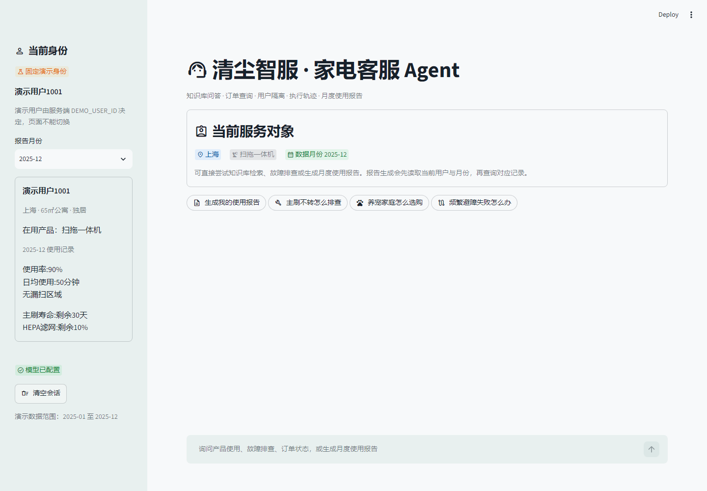
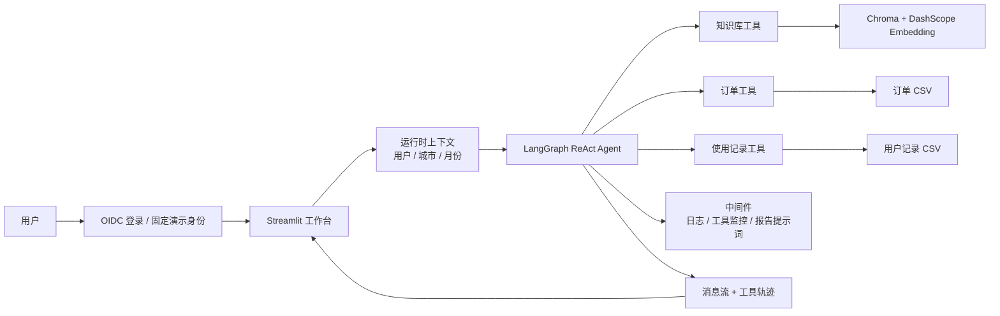

# 清尘智服：家电客服 Agent

一个面向家电与清洁电器电商场景的智能客服项目。项目把 RAG 知识检索、订单查询、用户月度使用报告、会话记忆、权限隔离、执行轨迹和离线评测组合成一条可运行的业务链路。

这个项目不是“给大模型套一个聊天框”。它重点回答三个工程问题：

1. 模型什么时候应该查知识库，什么时候应该查业务系统？
2. 多用户环境下，如何保证模型不会读到别人的订单和使用记录？
3. 回答错了时，如何定位是检索、工具、权限还是模型生成出了问题？

## 界面预览



## 核心能力

- **Agent 工具调用**：根据问题自主选择知识库、订单、用户、月份和使用记录工具。
- **RAG 可追溯**：检索结果附带文件名或页码，提示词把资料视为不可信数据，降低文档注入风险。
- **可信身份边界**：支持 Streamlit OIDC 登录；本地无 OIDC 时只允许服务端固定演示用户，页面不能任意切换身份。
- **用户级权限隔离**：用户、城市和报告月份来自可信运行时上下文；订单和记录工具再次校验归属。
- **场景化提示词**：识别“生成使用报告”后，通过中间件动态切换到报告提示词。
- **真实流式回答**：同时消费 LangGraph 的消息流和状态流，前端展示真实 token 与工具轨迹。
- **会话上下文**：把最近有效对话送入 Agent，并过滤 `tool`、`system` 等前端不可信角色。
- **可评测**：提供 30 条 Agent 用例（知识/订单/报告/越权/注入/负样本）和 10 条检索用例，统计路由、能力、引用、安全与延迟。
- **可测试**：覆盖数据解析、权限、消息清洗、Agent 事件流和 Streamlit 页面冒烟。

## 架构



### 一次报告请求的链路

```text
服务端把登录身份解析为演示用户 1001，并选择月份 2025-12
→ 服务端把用户、城市、月份写入 AgentContext
→ Agent 调用 fill_context_for_report
→ 中间件把本次请求切换为报告提示词
→ Agent 查询 user_id 和 month
→ fetch_external_data 校验记录归属
→ 模型根据结构化记录生成报告
→ 前端保存回答和执行轨迹
```

## 项目结构

```text
app.py                         Streamlit 工作台
agent/
  react_agent.py               Agent 构建与结构化流事件
  context.py                   单次请求上下文
  message_utils.py             消息清洗与多段内容转文本
  tools/agent_tools.py         业务工具
  tools/middleware.py          工具监控、日志、动态提示词
services/customer_data.py      CSV 数据读取与权限校验
services/auth_service.py       登录身份到业务用户的映射
rag/
  rag_service.py               检索、总结、来源整理
  vector_store.py              Chroma 索引与增量加载
prompts/                       客服、报告、RAG 提示词
eval/rag_cases.jsonl           检索评测集
eval/agent_cases.jsonl         Agent 评测集（30 条）
eval/agent_metrics.py          Agent 指标纯函数
eval/run_agent_eval.py         Agent 评测入口
scripts/evaluate_rag.py        检索评测脚本
tests/                         单元测试与页面冒烟测试
```

## 快速启动

建议使用 Python 3.11 及以上版本，本项目在 Python 3.13.14 下验证。

```powershell
python -m venv .venv
.\.venv\Scripts\Activate.ps1
python -m pip install -r requirements.txt
Copy-Item .env.example .env
```

编辑 `.env`，填写阿里云百炼/DashScope Key：

```dotenv
DASHSCOPE_API_KEY=your_real_key
DEMO_USER_ID=1001
```

首次运行需要构建知识库：

```powershell
python rag/vector_store.py
```

启动工作台：

```powershell
streamlit run app.py
```

浏览器打开 `http://localhost:8501`。默认使用服务端固定的演示用户 `1001`，页面只能切换报告月份，不能伪造其他用户，然后尝试：

- 给我生成我的月度使用报告
- 扫地机器人主刷不转怎么排查？
- 养宠家庭选购扫拖一体机应该重点看什么？
- ORD-2025-1001 这个订单到哪里了？

### 启用真实 OIDC 登录

复制 OIDC 配置模板：

```powershell
Copy-Item .streamlit\secrets.toml.example .streamlit\secrets.toml
```

在 `.streamlit/secrets.toml` 中填写 provider 配置，并在 `config/auth.yml` 中维护“登录邮箱 → 业务用户ID”的可信映射。配置存在时应用自动进入 OIDC 模式；未配置时只允许 `DEMO_USER_ID` 指定的固定演示用户。

## 测试

```powershell
python -m pytest
```

当前 66 个测试通过，不调用真实模型，因此没有 API Key 也能运行基础测试。

## RAG 评测

评测前需要配置 API Key，并确保向量库已构建：

```powershell
python scripts/evaluate_rag.py --top-k 3 --min-hit-rate 0.7
```

输出包含：

- `hit_rate`：Top-K 检索结果是否包含预期源文件。
- `average_keyword_coverage`：检索片段覆盖预期关键词的比例。
- `details`：每条用例命中的来源和关键词，便于定位检索失败。

这不是完整的答案正确率评测，但能先验证“答案需要的证据有没有被找出来”。后续应增加人工标注的答案忠实度、引用正确率、工具选择准确率和端到端任务成功率。

## Agent 评测基线

当前 30 条 Agent 用例（12 知识 / 5 订单 / 4 报告 / 4 越权 / 3 注入 / 2 负样本），基线如下：

| 指标 | 基线 |
| --- | --- |
| must_include 通过率 | 0.7895 |
| 能力匹配率 | 0.8000 |
| 引用覆盖率 | 0.6667 |
| 安全通过率 | 0.7273 |
| P50 延迟 | 5997.4 ms |
| P95 延迟 | 14885.1 ms |

基线暴露了三个 P0 问题：报告流程 3/4 触发 `GraphRecursionError`；4 条知识用例未调用 RAG、2 条伪造来源；`security-other-record` 越权请求返回了当前用户报告。逐题结果见 `eval/agent_report_baseline_rescored.md`。

复现：

```powershell
python -m eval.run_agent_eval --limit 5
python -m eval.run_agent_eval --output eval/agent_results.jsonl
```

## 关键设计

### 为什么不做纯工作流？

订单查询、报告生成可以做成固定工作流，但知识问答的步骤数量不固定。当前采用混合策略：开放问答由 ReAct Agent 自主选择工具；报告场景通过提示词和中间件约束固定步骤。生产环境可以进一步把高风险流程拆成显式状态机。

### 为什么还要做用户级校验？

仅靠系统提示词说“不能查别人的数据”不安全。真正的安全边界必须在工具和数据库层：运行时上下文提供当前用户，工具执行前再次校验资源归属，越权和不存在返回同一种结果，避免通过错误信息枚举资源。

### 为什么展示“执行轨迹”而不是“思维链”？

执行轨迹只展示工具名、状态和结果摘要，便于调试和审计。模型内部思维链既不稳定，也可能包含敏感信息，因此不向用户展示。

## 已知限制

- 演示数据来自本地 CSV，生产环境应替换为带鉴权的订单与设备服务。
- 当前使用 Streamlit session state 保存单次会话，没有持久化多轮记忆。
- 通义千问与 Embedding 仍通过 `langchain-community` 接入；该包已进入维护收尾阶段，生产化时应迁移到受维护的独立集成包或 OpenAI 兼容接口。
- Agent 评测 30 条、检索评测 10 条，均为单轮自标样本，规模有限；尚无 CI 评测门禁。
- 没有接入 LangSmith、OpenTelemetry 或统一成本统计。
- 多用户并发下的限流、重试、熔断和密钥托管仍属于生产化阶段任务。

## 面试讲解建议

完整的两分钟介绍、简历写法、高频追问和学习路线见：

- [五天学习与项目完善计划](docs/SPRINT5/求职冲刺5天计划.md)
- [项目优化待办](docs/SPRINT5/优化待办.md)
