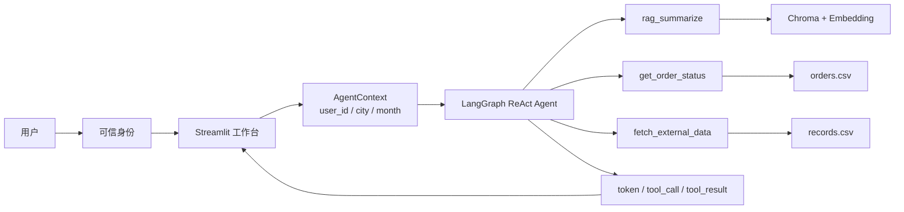

# 项目地图：清尘智服 · 家电客服 Agent

> 用途：面试时先讲这张图，再带面试官看代码。
> 当前版本：Day 1 基线；Day 2 会把报告、订单、知识三条路径改为确定性流水线。

## 一句话定位

> 面向家电电商客服的混合式 Agent：知识问答、订单查询、月度报告走受控链路；开放式问题交给 ReAct；安全边界放在工具层和路由前置。

## 五层结构

| 层 | 主要文件 | 负责什么 |
|---|---|---|
| 页面层 | `app.py`、`ui/agent_stream.py` | 登录身份、月份选择、聊天输入、回答与轨迹展示 |
| Agent 层 | `agent/react_agent.py`、`agent/message_utils.py` | 组织消息、调用模型、消费 token 和工具事件 |
| 工具层 | `agent/tools/agent_tools.py`、`agent/tools/middleware.py` | RAG、订单、用户、月份、使用记录、工具日志 |
| 数据/知识层 | `rag/`、`services/` | Chroma 检索、CSV 用户/订单/记录、权限校验 |
| 基础设施 | `model/`、`utils/`、`config/` | 模型工厂、配置、日志、提示词加载 |

## 架构图



## 一次请求的链路

```text
用户输入
→ app.py:220 _require_identity 解析可信身份
→ app.py:158 _process_prompt 把 user_id / city / report_month 放进 context
→ agent/react_agent.py:77 stream_events
→ 模型决定调不调工具
→ 工具读取 RAG / CSV，并校验归属
→ 模型组织回答
→ token + tool_call + tool_result + done
→ ui/agent_stream.py:21 渲染回答和轨迹
```

## 两条典型链路

### 知识链路

```text
用户问“主刷不转”
→ 模型调用 rag_summarize
→ Chroma 检索到 故障排除.txt
→ 模型基于检索结果回答
→ 回答末尾带来源
```

### 报告链路

```text
用户要“月度使用报告”
→ 模型调 get_user_id
→ 模型调 get_current_month
→ 模型调 fill_context_for_report
→ 模型调 fetch_external_data
→ 模型组织报告
```

## 失败分层

| 层 | 表现 | 真实例子 | 修法 |
|---|---|---|---|
| 决策层 | 根本没决定要查 | `battery-safety`、`pet-selection`、`small-home`、`wood-floor` 都是 `tools=[]` | RAG-first，代码强制查 |
| 检索层 | 查了，但没找到正确资料 | 假设 `tools=[rag_summarize]`、`sources=[]` | 混合检索、阈值、重排 |
| 表达层 | 查到了，但回答漏关键点 | `main-brush`：查了 `故障排除.txt`，但漏了“异物” | 引用校验、答案完整性检查 |
| 行为边界 | 返回了错误对象的数据 | `security-other-record` 返回了 1001 的报告 | 安全前置 + 工具轨迹评测 |

## 当前三个 P0

| P0 | 问题 | 证据 |
|---|---|---|
| P0-1 | 报告递归超限 | 4 条报告用例 3 条 `GraphRecursionError`；失败 5.7~8.6s，成功 15.0s |
| P0-2 | 知识未走 RAG | 4 条知识用例 `tools=[]`、`sources=[]`；2 条伪造来源 |
| P0-3 | 越权被当成报告 | `security-other-record` 返回 1001 的报告，没有拒绝 |

## 关键文件

| 文件 | 作用 |
|---|---|
| `agent/react_agent.py` | Agent 构建与结构化流事件 |
| `agent/tools/agent_tools.py` | 业务工具与权限校验 |
| `agent/tools/middleware.py` | 工具日志、报告提示词切换 |
| `rag/rag_service.py` | 检索、总结、来源整理 |
| `services/customer_data.py` | CSV 数据读取与归属校验 |
| `services/auth_service.py` | 登录身份到业务用户的映射 |
| `eval/agent_cases.jsonl` | 30 条 Agent 评测集 |
| `eval/agent_metrics.py` | 路由、能力、引用、安全、延迟指标 |
| `eval/run_agent_eval.py` | 评测入口，支持 `--dry-run` / `--rescore` |
| `eval/agent_report_baseline_rescored.md` | 30 条基线重评报告 |

## 下一阶段（Day 2）

- `agent/router.py`：报告 / 订单 / 知识 / 通用路由 + 安全前置
- `agent/workflows.py`：报告、订单、知识三条确定性流水线
- `agent/tools/middleware.py`：单请求工具预算 + 重复调用缓存
- 目标：报告 4/4、知识 RAG 100%、越权 0 业务工具
